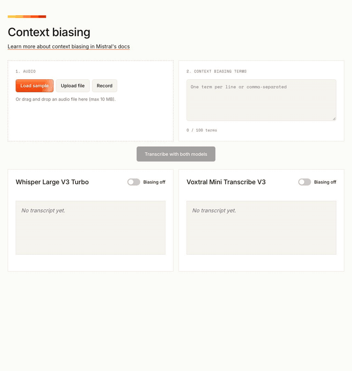
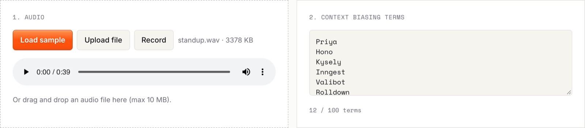
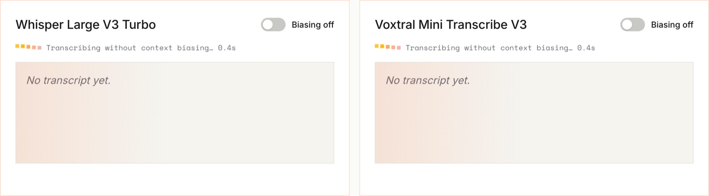
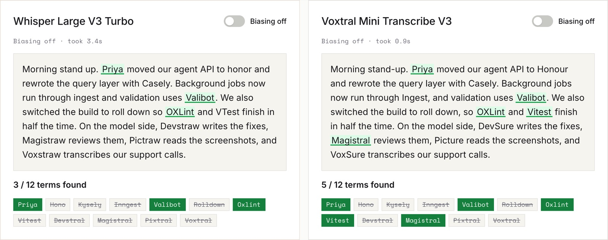
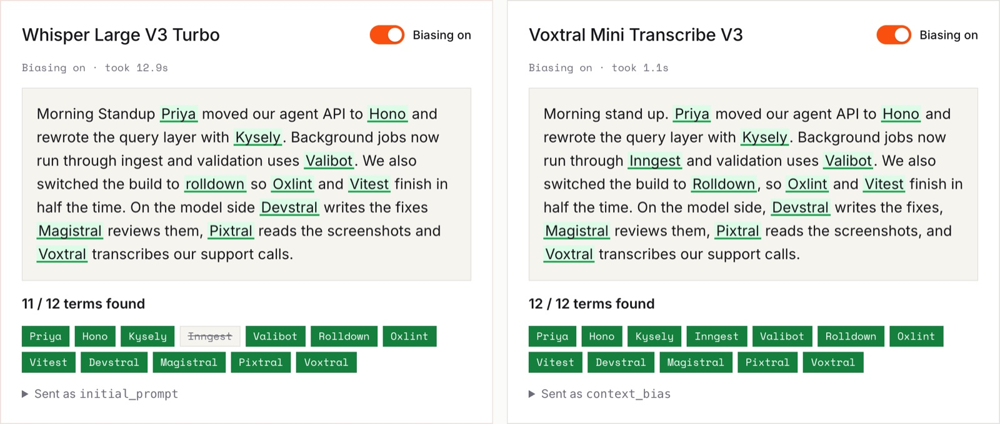
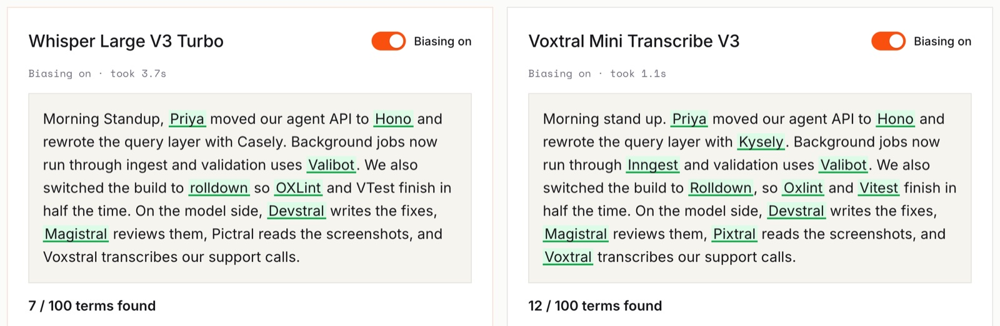
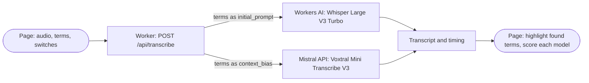
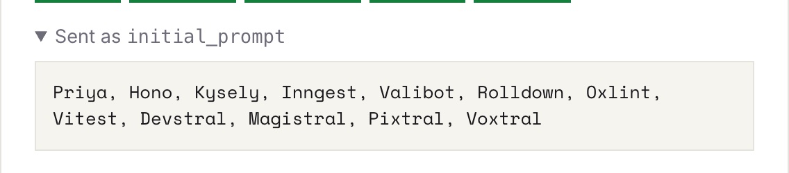
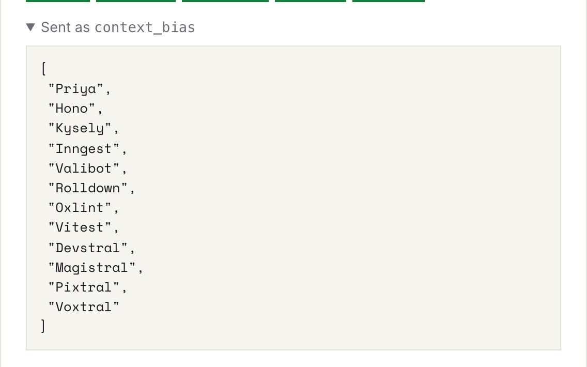

<div align="center">

# Context biasing

**Give a speech model your team's vocabulary and watch it spell Kysely, Inngest and Devstral right.**

A side-by-side demo of context biasing in [Voxtral Mini Transcribe V3](https://docs.mistral.ai/studio/audio/speech_to_text/offline_transcription#context-biasing) and [Whisper Large V3 Turbo](https://developers.cloudflare.com/workers-ai/models/whisper-large-v3-turbo/), running on [Cloudflare Workers](https://developers.cloudflare.com/workers/).

**[Try the live demo](https://context-biasing.mistraldemo.workers.dev)**



</div>

## What it does

<table>
<tr>
<td align="center" width="25%"><br><sub>Load the sample and its 12 terms</sub></td>
<td align="center" width="25%"><br><sub>Both models transcribe at once</sub></td>
<td align="center" width="25%"><br><sub>Biasing off: 3 and 5 of 12</sub></td>
<td align="center" width="25%"><br><sub>Biasing on: 11 and 12 of 12</sub></td>
</tr>
</table>

- **Compares both models on the same audio.** One click sends your recording to Whisper and Voxtral in parallel and shows how long each took.
- **Switches biasing per model.** Flip a model's switch and only that model runs again, so you see the before and after a few seconds later.
- **Shows which terms came out right.** Found terms are highlighted green in the transcript; missed ones are crossed out underneath, with a score.
- **Shows exactly what each model received.** Expand "Sent as" to see Whisper's `initial_prompt` and Voxtral's `context_bias` list.
- **Takes your own audio too.** Upload or drop a file up to 10 MB, or record from your microphone.



With a realistic 100-term list, where only 12 of the terms are actually spoken, Whisper finds 7 of them and Voxtral still finds all 12.

### Try it with the sample

Click **Load sample**. It loads a 39-second recording of the script below (`public/samples/standup.wav`) and fills in the short list. Then:

1. Click **Transcribe with both models** with both switches off.
2. Turn biasing on for each model.
3. Replace the terms with the long list and click **Transcribe with both models** again.

> Morning standup. Priya moved our agent API to Hono and rewrote the query layer with Kysely. Background jobs now run through Inngest, and validation uses Valibot. We also switched the build to Rolldown, so Oxlint and Vitest finish in half the time. On the model side, Devstral writes the fixes, Magistral reviews them, Pixtral reads the screenshots, and Voxtral transcribes our support calls.

To record it yourself: Kysely is "KEE-seh-lee", Inngest is "ingest", Valibot is "VAL-ee-bot", Hono is "HOH-no". The "-stral" names rhyme with "Mistral".

**Short list (12 terms).** All of these are spoken in the script.

```
Priya, Hono, Kysely, Inngest, Valibot, Rolldown, Oxlint, Vitest, Devstral, Magistral, Pixtral, Voxtral
```

**Long list (100 terms).** The 12 terms above, shuffled in with 88 real Mistral, Cloudflare and JavaScript names that are not in the script, like a team's full vocabulary.

```
SvelteKit, Auth0, Hasura, VoidZero, Mistral, Better Auth, Shieldstral, Turborepo, Meilisearch, RabbitMQ, Rolldown, Grafana, Hyperdrive, Redis, Miniflare, Vectorize, Terraform, Le Chat, Voxtral, Okta, Strapi, Zaraz, CockroachDB, PlanetScale, Sequelize, Postmark, Storybook, ArkType, Codestral, Oxlint, Remix, Supabase, NestJS, Upstash, Kysely, Magistral, MikroORM, tsgo, Turso, R2 SQL, Astro, Wrangler, Workers KV, Kafka, Pixtral, Zod, Playwright, Hono, Tailwind, esbuild, Nuxt, Prisma, Vitest, Jotai, Mistral Large, Datadog, Ministral, pnpm, TanStack, Biome, Drizzle, Svelte, SQLite, Priya, Agents SDK, Vibe, Webpack, AI Gateway, Forge, BullMQ, Deno, Robostral Navigate, Mongoose, Fastify, Preact, Contentful, Inngest, SolidJS, Mistral Small, Oxc, Algolia, Sentry, Kubernetes, Devstral, Mistral Medium, Durable Objects, Babel, Rspack, SendGrid, Workers AI, Mistral OCR, Valibot, Leanstral, Zustand, Nx, Pulumi, Typesense, Twilio, tRPC, Elysia
```

**Reference results.** Spoken terms transcribed correctly, out of 12, with the sample recording. Your own voice will give different numbers.

| Terms sent | Whisper Large V3 Turbo | Voxtral Mini Transcribe V3 |
| --- | --- | --- |
| Biasing off | 3 | 5 |
| Short list (12 terms) | 11 | 12 |
| Long list (100 terms) | 7 | 12 |

## How it works



1. The page sends the audio, the terms and the switch state to `POST /api/transcribe`, once per model, in parallel.
2. For Whisper, the Worker calls `@cf/openai/whisper-large-v3-turbo` through the Workers AI binding and passes the terms as a comma-separated `initial_prompt`. It took 3 to 13 s per run in testing.
3. For Voxtral, the Worker forwards the audio to Mistral's `/v1/audio/transcriptions` endpoint with `model=voxtral-mini-transcribe-3` and one `context_bias` field per term, with spaces turned into underscores. It took 1 to 2 s per run in testing.
4. With a switch off, that model gets no terms at all.
5. The page marks every term it finds in each transcript (ignoring case, and treating spaces, hyphens and underscores alike) and counts the score.

<table>
<tr>
<td width="50%"></td>
<td width="50%"></td>
</tr>
<tr>
<td align="center"><sub>Whisper gets the terms as one text prompt</sub></td>
<td align="center"><sub>Voxtral gets them as a list of up to 100 terms</sub></td>
</tr>
</table>

One TypeScript Worker and one HTML page with plain CSS and JavaScript. No frontend build step.

```
src/index.ts        the Worker: /api/transcribe, calls Whisper and Voxtral
public/index.html   the page
public/samples/     the sample recording
docs/               README images
```

## Run it locally

You need [Node.js](https://nodejs.org/en/download) 22 or later, a [Cloudflare account](https://developers.cloudflare.com/fundamentals/account/create-account/) for Workers AI, and a [Mistral API key](https://docs.mistral.ai/getting-started/quickstart) with access to `voxtral-mini-transcribe-3`. Workers AI runs on Cloudflare even in local development, so Whisper calls may count towards your usage.

```bash
git clone https://github.com/megaconfidence/context-biasing.git
cd context-biasing
npm install
npx wrangler login
echo "MISTRAL_API_KEY=your-key-here" > .env
npm run dev
```

Open <http://localhost:8787> and click **Load sample**, then **Transcribe with both models**.

### If Voxtral says "Invalid model"

Your key doesn't have access to `voxtral-mini-transcribe-3`, or Wrangler is using a different key: a `MISTRAL_API_KEY` exported in your shell overrides `.env`. Run `unset MISTRAL_API_KEY` and start `npm run dev` again.

### Deploy

`npm run deploy` deploys the Worker and uploads `MISTRAL_API_KEY` from `.env` as a secret.

### Settings

| What | Where | Default |
| --- | --- | --- |
| Mistral API key | `MISTRAL_API_KEY` in `.env` | none |
| Voxtral model | `VOXTRAL_MODEL` in `src/index.ts` | `voxtral-mini-transcribe-3` |
| Whisper model | `WHISPER_MODEL` in `src/index.ts` | `@cf/openai/whisper-large-v3-turbo` |
| Max terms | `MAX_TERMS` in `src/index.ts` and `public/index.html` | `100` |
| Max audio size | `MAX_AUDIO_BYTES` in `src/index.ts` and `public/index.html` | 10 MB |
| Sample audio and terms | `SAMPLE_AUDIO_URL` and `SAMPLE_TERMS` in `public/index.html` | `public/samples/standup.wav`, 12 terms |
